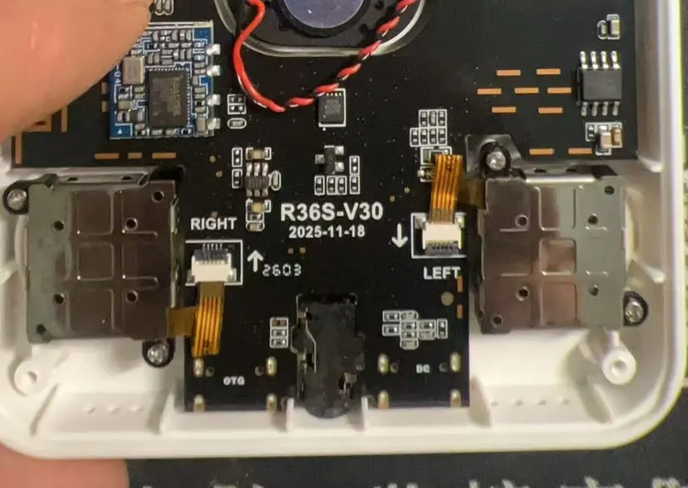
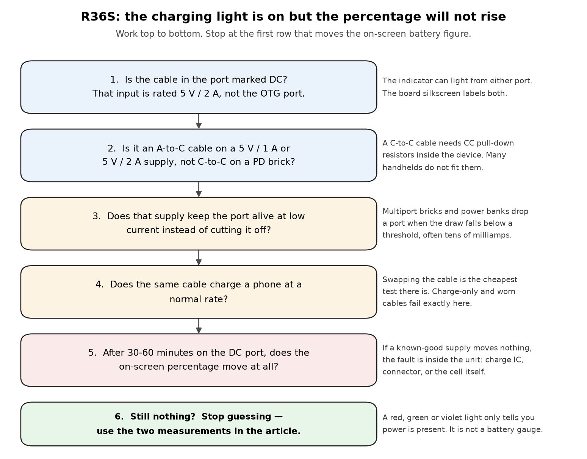
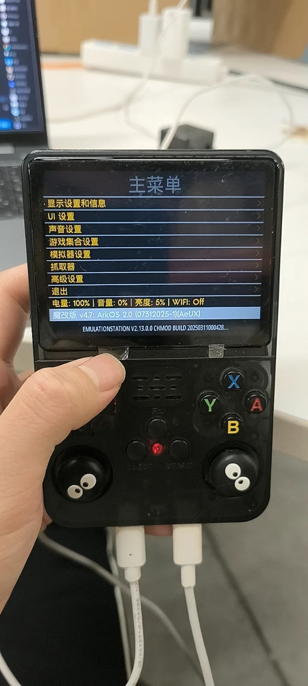
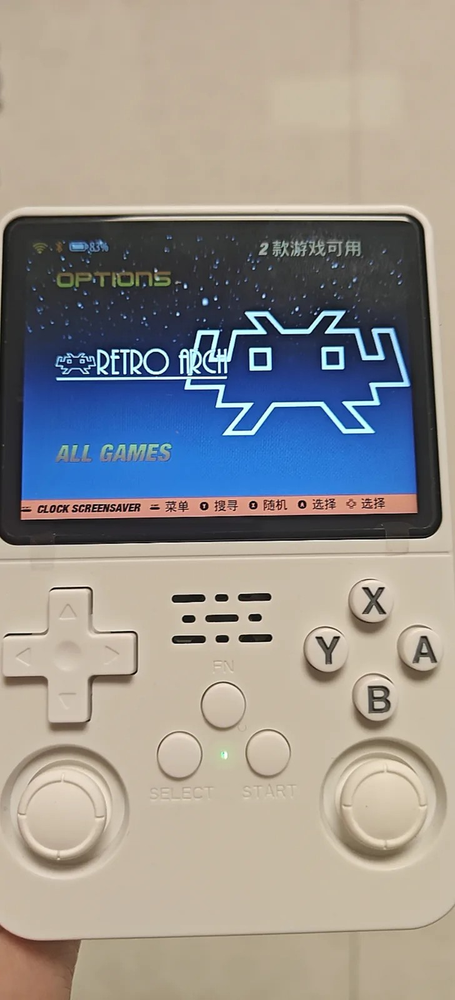
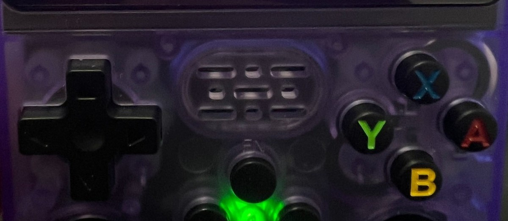
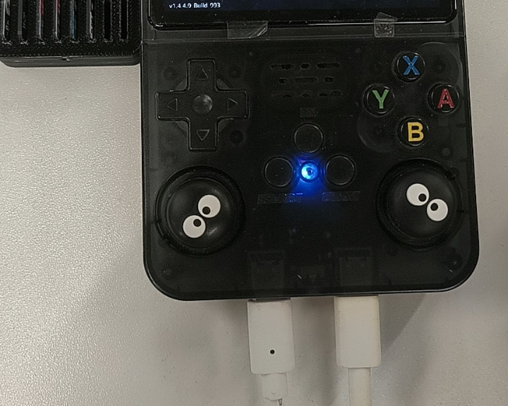

# R36S charging light stays on but the battery won't rise — charging, battery and standby drain

**English** · **[中文](README.zh-CN.md)**

> **Short answer.** The R36S charges from one port only: the one the board silkscreens **DC**, rated **5 V / 2 A max**. If you are charging from a **USB-C-to-USB-C** cable on a Power Delivery brick, swap to a **USB-A-to-USB-C** cable on a plain 5 V brick — that single change is the most common fix for "the light is on and the percentage never moves". The indicator light is **not** a battery gauge: on our own units the same LED reads green when the machine is running, red while a cable is attached, and violet on a third unit. Read the percentage on screen, not the light.
>
> **The "fast charger killed my amp chip" question has no verified answer.** We looked, and we are not going to pretend otherwise — see [§ Is a fast charger dangerous?](#is-a-fast-charger-dangerous-honestly-no-consensus).
>
> **Standby drain is real and it is not a bug.** This platform has no true suspend. Powered off it holds charge; left on at the menu, or paused mid-game with WiFi up, it will be flat by morning.

---

## Symptoms: what owners actually report

These are verbatim messages from Chinese handheld QQ groups, taken from a read-only export of 22,869 unique group messages. Only the group name is given; the export cannot reliably attribute a message to a person.

| Group | What was said (verbatim, Chinese) |
|---|---|
| R36S掌机爱好者 | `大家好，新人刚来。自己有台R36S掌机，充电长时间一直亮粉紫色灯光，电量不见上涨，换过充电头和数据线也没能解决，想来请教下各位大佬该怎么处理` |
| R36S掌机爱好者 | `问一个问题，是不是用快充头充电是不是有概率会把功放芯片整坏？` |
| 安伯尼克掌机交流群 | `34xx玩gba也能4/5小时，就是待机不行，不关机放一晚上第二天价基本会空电` |
| 安伯尼克掌机交流群 | `开源是没待机` |
| 安伯尼克掌机交流群 | `便携最少要能有4-5小时续航` |
| 安伯尼克掌机交流群 | `续航不行 别的不用换` |
| 安伯尼克掌机交流群 | `掌机没续航都是白扯` |
| 安伯尼克掌机交流群 | `充电太慢了` |
| 安伯尼克掌机交流群 | `嗷我应该是用了两年多电池剩80多不太耐电了` |

Most of these are really one question — *"is my unit broken, or am I doing something wrong?"* — and the answer is usually the second one.

**About this data.** No date range, no per-message timestamps, no speaker attribution, and at least three related groups were captured only by name and announcement, not by message body. Everything above is quoted as it was extracted; nothing is paraphrased.

---

## Why this happens

### 1. There are two ports and they are not interchangeable

The unit has two connectors side by side on the bottom edge. The board silkscreen labels them **OTG** and **DC**: OTG is the data port (a USB WiFi dongle goes there), DC is the charging input rated 5 V / 2 A.

Two facts about "which side" are worth separating, because they are the source of a lot of confusion out there:

- **The shop's specification calls the charging input the left DC port**, and the supplier says the same thing in the same words: the port on the left is DC.
- **The board silkscreen labels the pair `OTG` and `DC`**, and on our sample boards the two labels sit either side of the pair of connectors. Which label is physically left of the other depends on whether you are looking at the front of the unit or at the board with the shell off — a mirror — and we are not going to pretend we have resolved that for every batch.

So the instruction that survives all of it is the one our own FAQ gives: **find the port marked DC, and check that marking on your unit rather than trusting the word "left".**



*A V30 sample board from our own stock. The two bottom connectors are silkscreened `OTG` and `DC`; the twisted red/black lead in the middle is the battery plug. Photograph of a supplier sample, shown unaltered.*

**A cable in the wrong port is a live suspect.** That is one plausible explanation for the first message in the table above: light on, nothing happening, and swapping cables and bricks changes nothing because neither was ever the problem.

> ⚠️ 未实测：that a charger in the **OTG** port lights the indicator while the cell does not charge is a report we have not measured. What we do have is our own photograph of a unit with **both** ports populated at once — which is exactly how this confusion starts. Treat "try the other port" as a free two-second test, not as a diagnosis.

> ⚠️ Not independently verified: which connector sits under which label on *every* batch, and the connector type itself. Our evidence is the silkscreen on our own sample boards plus our own photographs, in which both ports take the same plug shell. Check the marking on your own unit — our own FAQ says the same thing, for the same reason.

### 2. USB-C to USB-C on a PD charger delivers 0 V

This is a USB-C specification consequence, not an R36S quirk.

A USB-C source only applies 5 V to VBUS after it sees the right pull-down resistor (Rd, nominally 5.1 kΩ) on the CC line. A device whose USB-C-shaped receptacle has no CC resistors therefore looks like *nothing is plugged in* to a modern USB-C source. A USB-A port has no such handshake — it just outputs 5 V — which is why an A-to-C cable works where a C-to-C cable does not.

So the practical consequence is surprising and worth stating plainly:

| Supply | Cable | Expected result |
|---|---|---|
| Plain 5 V / 1 A or 5 V / 2 A USB-A brick | USB-A → USB-C | Plain 5 V output, no negotiation — the configuration our own spec describes |
| Laptop USB-C brick (PD) | USB-C → USB-C | Charger sees no negotiation and can sit at 0 V |
| Power bank, USB-A socket | USB-A → USB-C | Fine |
| Power bank, USB-C socket only | USB-C → USB-C | Same 0 V problem |

> ⚠️ 未实测 / not measured by us. We have not put a meter on our units to record VBUS for each combination, and the CC-resistor explanation is engineering background rather than a measurement we made. We list the cable swap first because it is free, reversible, and reported by other community write-ups as well — not because we have bench data.

### 3. Chargers and power banks that shut the port off

Multi-port bricks and power banks commonly drop a port when the load falls below a threshold — often tens of milliamps. A handheld that is nearly full, or one that is asleep and drawing a trickle, can fall under it. The port cuts, the device sees no supply, and you get exactly the symptom in the group quote: a light, and no movement. Try a single-port brick, or a different port on the multiport one.

### 4. The cable itself

Charge-only cables (no data lines), worn cables and thin conductors all fail at the current the device wants. The cheapest diagnostic in this whole article is: **plug the same cable and brick into a phone and see whether the phone charges at a normal rate.** If it doesn't, you have found the problem without touching the handheld.

### 5. A deeply discharged cell

If the battery has been flat for a long time, the pack's protection circuit may have cut the output, and the unit can take a long time on a supply before anything visible happens. Give it a couple of hours on a known-good 5 V / 1 A or 2 A supply before you conclude the unit is dead.

### 6. Then it is inside the unit

If a known-good supply and a known-good cable on the **DC** port produce no movement in 30–60 minutes, the remaining candidates are the charge circuit, the connector's solder joints, or the cell. At that point the useful action is not another charger — it is the shop you bought it from. A unit bought from us is covered by a 7-day change-of-mind return and by email/Discord support; ask before you open the shell or replace the cell.

---

### Is a fast charger dangerous? Honestly: no consensus

The group message is a question, not a report: `是不是用快充头充电是不是有概率会把功放芯片整坏？` — *"is there a chance a fast charger destroys the amplifier chip?"*

Here is what we can say, and what we cannot.

**What is engineering fact.** A compliant USB charger does not push power. Its wattage rating is a ceiling it offers, not a voltage it imposes. Power Delivery only raises voltage above 5 V after an explicit negotiation with the device. A device that never negotiates never gets more than 5 V from a compliant source. So "a 65 W brick will force 65 W into a 5 V / 2 A handheld" is not how the hardware works.

**What we could not establish.** We found **no verified failure analysis** linking a fast charger to a damaged audio amplifier on an R36S — no teardown, no measurement, no reproducible case. What circulates is a question, repeated. And there is a real, documented amplifier-related symptom on this platform that has nothing to do with chargers: WiFi builds have a **faint speaker hum**, which our own product page discloses and which is why we list it as a tradeoff of the WiFi option rather than a fault.

**So: no conclusion, deliberately.** If you want the risk-minimising choice, it is also the cheapest one: a USB-A brick at 5 V / 1 A or 5 V / 2 A with an A-to-C cable. Not because we proved fast chargers break anything, but because the device cannot use more, so anything more is pure downside. **Do not read that advice as an admission that fast chargers cause damage — we have no evidence either way.**

---

### "It's flat by morning" — system, or hardware?

**Mechanism 1, and the usual answer: there is no true standby on this platform.** `开源是没待机` — *"open-source handhelds have no standby"* — is how the group puts it, and it matches the platform: a handheld running a plain Linux build with a front-end on top has no phone-style suspend-to-RAM with a hardware wake path. On builds of this class the power control is generally wired to a **shutdown**, not to a suspend. If you leave it at the menu, or paused inside a running game, the SoC is still on, the backlight is still on, and — if WiFi is up — the radio is still up. A night of that is a night of full-power idle draw.

> ⚠️ 未实测：we have not instrumented a unit to measure current draw in each state, and we have not verified the power-control mapping on all three board revisions. The behaviour above is what the platform and the group reports describe; the *test* below is what you can actually rely on, because it measures your own unit.

So the honest test has two parts, and they are one night apart:

1. **Shut down properly** (menu → quit/shutdown, not the slider alone, not just closing the lid), then confirm the screen is black and the indicator is off. Leave it 12 hours.
2. **Boot it and read the percentage.** A healthy unit holds most of its charge across a full shutdown. If the indicator is still lit after you shut down, you did not halt — that is mechanism 1, and nothing is broken.

Even a properly halted unit has some quiescent drain and normal cell self-discharge, so "it lost a few percent over a night doing nothing" is not by itself a fault. What is a fault is a unit that is flat.

**Mechanism 2: the cell is old.** The group message above is the giveaway — `用了两年多电池剩80多不太耐电了` — *"two-plus years old, down to the low 80s percent and it doesn't hold much"*. Cells age. If a unit that used to last four hours now lasts two, no cable, charger or firmware will fix it.

---

## What runtime should you actually expect?

| Claim | Source | Status |
|---|---|---|
| Roughly 4–5 hours on GBA-class games | QQ groups, repeatedly | Community report, not our measurement |
| "Portable must do at least 4–5 hours" | QQ group, stated as a requirement | Community expectation |
| 4–6 hours advertised | Marketing claims on marketplace listings | Manufacturer/marketplace claim |
| 2–3 hours empty-to-full on a 5 V / 2 A brick | Community write-ups | ⚠️ We have not timed a full charge |

Battery capacity is a case where we will show you our own paperwork instead of a clean number, because our own paperwork disagrees with itself:

| Figure | Where it comes from |
|---|---|
| 3.7 V, 3000 mAh, 11.1 Wh, cell marking **JLCL 804069P** | Our supplier-sourcing record for the pack |
| 3200 mAh | Our international-shipping paperwork (the pack is declared as UN3481 built-in lithium) |
| 3200–3500 mAh | Public marketplace listings |
| **≈ 11 Wh** | The one thing all of the above agree on |

> ⚠️ 未实测：we have not opened units of all three revisions and read the cell label ourselves, so we do not publish a single capacity number as fact. Treat the pack as roughly 11 Wh and judge runtime by what you measure.

The two things that move runtime most, and both are free: **screen brightness** and **what you are emulating**. 8-bit and 16-bit systems sip power; PS1, N64 and Dreamcast drink it. WiFi up costs you too.

---

## How to fix it

Work top to bottom and stop at the first row that makes the on-screen percentage move.



1. **Find the right port.** Use the connector the board marks **DC**. If nothing happens, *try the other one anyway* — it costs nothing and the two ports are genuinely easy to confuse.
2. **Change the cable to USB-A-to-USB-C** if you were using C-to-C. This is the single highest-yield action.
3. **Use a plain 5 V / 1 A or 5 V / 2 A brick**, single-port if you have one, and avoid a power bank's USB-C-only socket.
4. **Test the cable on a phone.** If the phone charges slowly or not at all, stop here — you have found it.
5. **Give a flat unit 30–60 minutes** before judging anything. Don't unplug and re-plug every two minutes; you cannot tell trickle from nothing that way.
6. **Measure, if you have the tools.** An inline USB meter between the brick and the cable tells you the truth immediately: a working charge shows volts *and* current. Measure from a partly discharged battery, because a full one legitimately falls to near zero current.
7. **Check the percentage the honest way.** Both stock and vendor front-ends put the battery figure on screen — see the photographs below. Note it, charge for an hour with the unit **off**, then boot and compare. If it moved, the charging path works and your problem was the supply or the cable.
8. **Only then suspect the unit.** Known-good supply + known-good cable + right port + an hour + no movement = contact the seller.

### If you want to read it from a shell

This is the standard Linux power-supply interface. Run it on the device (ArkOS-based builds are Linux, so it may be there):

```bash
ls /sys/class/power_supply/
```

On a normal Linux laptop that prints something like:

```
ADP0  BAT0  ucsi-source-psy-USBC000:001
```

and then, if a battery node exists:

```bash
cat /sys/class/power_supply/BAT0/capacity
cat /sys/class/power_supply/BAT0/status
```

> ⚠️ **未实测 on the R36S.** We have not verified that ArkOS on the R36S exposes a `power_supply` battery node with those names, and on machines that use a vendor kernel the node may be absent or named differently. The output above is from an ordinary Linux laptop, not from an R36S. If `ls` returns nothing, use the on-screen percentage instead — that is what we do.

---

## How to verify the fix

You are fixed when, and only when, **the number moves**:

1. Read the on-screen battery percentage. Photograph it if you like — it removes the argument later.
2. Shut the unit down, connect the **DC** port with your A-to-C cable and a 5 V brick.
3. Leave it one hour, untouched, unit off.
4. Boot it and read the percentage again.

A rise of several points means the charging path is good and the original problem was the supply or the cable. No rise on a supply you have already proven on a phone means the fault is inside the unit.

For the standby question, verification takes one night: shut it down *properly*, confirm the indicator is off, leave it 12 hours, then boot. Indicator still lit after shutdown = you never halted it, and that is your drain.

- Good: percentage rises on the **DC** port; indicator off after shutdown; unit holds charge overnight powered off.
- Bad: percentage static after an hour (see [§ How to fix it](#how-to-fix-it)); indicator still lit after shutdown (the unit did not halt); unit flat after a night switched **off** (cell or board fault — talk to the seller).

### The indicator colours we have actually photographed

| Photograph | Indicator | State |
|---|---|---|
| [`docs/01-charging-over-usb-menu.jpg`](docs/01-charging-over-usb-menu.jpg) | **red** | Charging over USB; on-screen menu footer reads `电量: 100%` |
| [`docs/02-stock-status-bar-battery.jpg`](docs/02-stock-status-bar-battery.jpg) | **green** | Vendor stock system running, nothing attached; status bar reads `83%` |
| [`docs/03-indicator-green-closeup.jpg`](docs/03-indicator-green-closeup.jpg) | **green** | Supplier sample, unit running |
| [`docs/04-indicator-blueviolet-two-cables.jpg`](docs/04-indicator-blueviolet-two-cables.jpg) | **blue-violet** | Two cables attached. We cannot say which state this represents — which is the point |



*A real unit charging over USB. The indicator (centre of the controls, below the speaker grille) is **red**, and the vendor front-end's footer reads `电量: 100% · 音量: 0% · 亮度: 5% · WiFi: Off`. Photograph supplied by an owner — the screen shows the vendor's own system menu, not a game.*



*A white unit on the vendor's stock front-end, nothing attached. The status bar carries a WiFi icon, a Bluetooth icon and a battery icon reading `83%`; the same physical indicator is **green** here. Photograph supplied by an owner.*



*Same LED position, **green**, on a transparent purple sample. Supplier sample photograph, shown unaltered, no screen in the crop.*



*Two cables attached and a **blue-violet** indicator. Cropped below the screen on purpose: the indicator is the subject, and the original frame carries a commercial game's artwork. We do not have a documented colour-to-state table for this LED, and we are not going to invent one.*

---

## How to avoid it next time

- **Label your charging setup.** Keep one USB-A 5 V brick and one A-to-C cable that are *the* charging kit for this handheld. The failure in the group quotes above is nearly always a supply that works fine for a phone and cannot charge this device.
- **Put the cable in the port you have confirmed to be DC**, and check the marking rather than the side, because "left" depends on which way you are holding it.
- **A charging cable is not in the box.** Our own product page says so explicitly. Buy a USB-A-to-USB-C cable *with* the handheld, not after the first flat battery.
- **Shut it down instead of walking away from it.** Menu → shutdown, every time, or accept a flat unit in the morning. If you mostly play short sessions, this is the one habit that changes the most.
- **Turn WiFi off when you are not using it** — and note the disclosure before you buy it: WiFi builds have a faint speaker hum, and disabling USB or network settings can require reflashing to get WiFi back.
- **Check the percentage, not the colour.** Every false alarm in the table at the top of this page is somebody reading an LED.
- **Don't buy a bigger battery to cure a charging fault.** If the port, cable or supply is wrong, a bigger pack changes nothing. And a worn cell is only a real diagnosis *after* steps 1–4 above.

---

## What we measured, what we did not

Because this is the part that usually gets skipped:

| Claim in this article | How we know |
|---|---|
| Charging input is 5 V / 2 A max, on the port marked DC | Our own product specification and the supplier's statement; the board silkscreen in our photographs reads `OTG` and `DC` |
| There are two ports on the bottom edge and they are not interchangeable | Board silkscreen + our own photographs of a unit with both populated |
| Both ports take the same plug shell | **Our own photographs.** ⚠️ We have not confirmed the connector type on every batch — check the `DC` marking on your unit |
| The indicator reads red while charging and green while running | **Our own photographs** of real units (see above) |
| The indicator is not a documented battery gauge; one of our photos shows violet | **Our own photographs**; the absence of documentation we verified by finding no colour table anywhere |
| 3000 mAh vs 3200 mAh discrepancy | **Our own internal records** disagree with each other; we published the disagreement instead of picking a number |
| C-to-C on a PD source can deliver 0 V | USB-C specification behaviour, plus independent community write-ups. ⚠️ **Not** measured on our bench |
| Fast chargers damaging the amplifier chip | ⚠️ **No verified case found either way.** No conclusion is drawn |
| 2–3 h to full charge, 4–6 h runtime | ⚠️ Third-party claims. **Not** timed by us |
| A `power_supply` node exists on the R36S | ⚠️ **Not verified.** The example output is from an ordinary Linux laptop |

The two diagrams in this article are drawn by `tools/make-checklist.py` from literal shapes and text, not by an
image model; the six files in `docs/` are either crops of real photographs or that generated diagram, and each
caption says which it is.

No price, version number, part number, command or file path in this article is invented. Group quotations are verbatim (including their typos), attributed only to the group, because the source export cannot attribute them to a person.

---

## Related

- The bare R36S, its board revisions and 14 finishes → <https://r36s.space/products/r36s>
- First-steps guide, including which port charges and what a "bare" purchase includes → <https://r36s.space/guide>
- Shop FAQ, including the charging and WiFi disclosures → <https://r36s.space/faq>
- Before-you-buy checklist → <https://r36s.space/blog/bare-r36s-checklist>
- V12 / V21 / V30 buying guide, RAM evidence and who should *not* buy one → this shop's companion repository, `r36s-buying-guide-v12-v21-v30`
- Questions before or after a purchase → <https://r36s.space/contact> or the Discord linked from the shop

*Written by the shop behind [r36s.space](https://r36s.space). We sell these handhelds, so read the sections where we tell you not to buy something as the ones that cost us money. Licensed MIT.*
